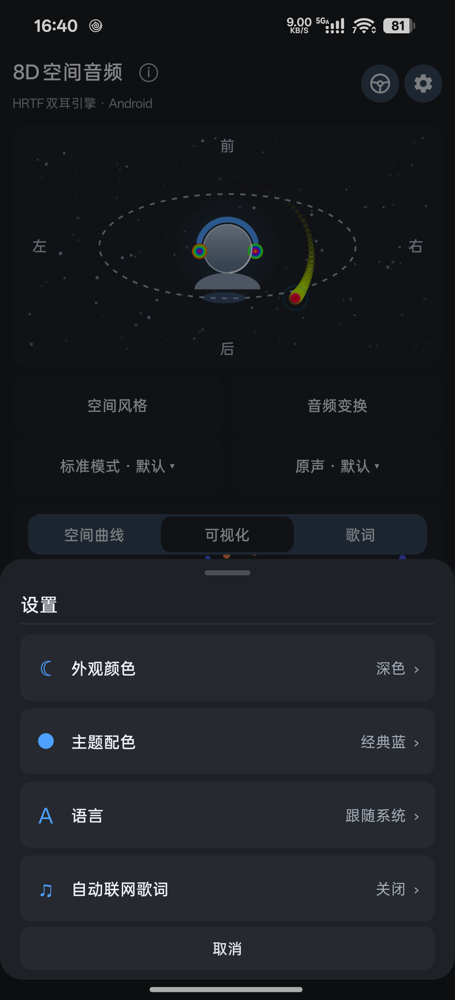

# 8D Space Audio

[简体中文](#简体中文) | [English](#english)

## 简体中文

8D Space Audio 是 Android 本地空间音频播放器，使用 Kotlin、原生 Android View 和 C++ DSP 构建。

### 下载

正式签名的 APK 将发布在 [GitHub Releases](https://github.com/oh-jy/8dmusic-core/releases)。支持 Android 7.0 及以上、arm64-v8a 设备。仅从可信发布渠道下载安装。

### 功能

- 本地音乐扫描、文件选择、后台播放、播放列表与收藏。
- 空间轨迹、混响、倍速、半音、倒放与降噪；支持 WAV 本地音频导出。
- 波形、频谱、声谱、粒子等音频可视化，以及驾驶模式。
- LRCLIB 歌词搜索和缓存；自动联网歌词默认关闭，手动搜索仍会联网。
- SomaFM 公开直播入口和 HTTPS 自定义流；不提供电台或麦克风录音。
- 深色、浅色和跟随系统主题，支持简体中文、繁体中文和英文。

### 隐私与权利

本应用没有维护者服务器，不上传本地音频。联网检索会将搜索歌名发送给 LRCLIB；播放电台会连接相应服务。公开直播和歌词不等于无版权，请只使用和导出你有权使用的内容。详情见 [隐私政策](PRIVACY.md)、[使用条款](TERMS.md)、[第三方来源](THIRD-PARTY-SOURCES.md)和[依赖声明](THIRD-PARTY-NOTICES.md)。

## English

8D Space Audio is an Android local spatial-audio player built with Kotlin, native Android Views, and C++ DSP.

### Download

Officially signed APKs will be available on [GitHub Releases](https://github.com/oh-jy/8dmusic-core/releases). Android 7.0 or newer and an arm64-v8a device are required. Install only from trusted release channels.

### Features

- Local music scanning, file picker, background playback, playlists and favorites.
- Spatial trajectories, reverb, speed, pitch, reverse and noise reduction; WAV export for local audio.
- Waveform, spectrum, spectrogram, particle visualizations and driving mode.
- LRCLIB lyrics search and cache. Automatic online lyrics are off by default; manual searches use the network.
- SomaFM public streams and custom HTTPS streams; no radio or microphone recording.
- Dark, light and system themes; Simplified Chinese, Traditional Chinese and English.

### Privacy and rights

The app has no maintainer-operated server and does not upload local audio. Lyrics search sends the search title to LRCLIB; radio connects to the selected provider. Public streams and lyrics are not necessarily copyright-free. Use and export only material you have rights to use. See the [privacy policy](PRIVACY.md), [terms](TERMS.md), [third-party sources](THIRD-PARTY-SOURCES.md) and [notices](THIRD-PARTY-NOTICES.md).

## Screenshots / 界面截图



## Build / 构建

JDK 21, Android SDK 34, Android NDK 27.2.12479018 (for native rebuilds). / 需要 JDK 21、Android SDK 34，以及重新构建原生库时的 Android NDK 27.2.12479018。

```powershell
$env:JAVA_HOME = 'C:\path\to\jdk-21'
$env:ANDROID_HOME = 'C:\path\to\android-sdk'
$env:ANDROID_SDK_ROOT = $env:ANDROID_HOME
.\gradlew.bat :core:test :app:testDebugUnitTest :app:assembleDebug
```

The APK is at `build/outputs/apk/debug/app-debug.apk`. To rebuild native libraries, set `ANDROID_NDK_HOME` to the NDK directory and run `.\build-native.ps1`. Release builds require a signing key; never commit the keystore or credentials. / Debug APK 路径为 `build/outputs/apk/debug/app-debug.apk`；重建原生库时设置 `ANDROID_NDK_HOME` 并运行 `.\build-native.ps1`。正式包需要签名密钥，请勿提交密钥或密码。

## License & contact / 许可证与联系

Original project code is licensed under [Apache-2.0](LICENSE). Third-party services, content and trademarks have their own rights and terms. / 项目原创代码采用 [Apache-2.0](LICENSE)；第三方服务、内容和商标的权利及条款独立适用。

Security, privacy or rights inquiries: ooh.jiangy@gmail.com. / 安全、隐私及权利问题请发送邮件至 ooh.jiangy@gmail.com。
